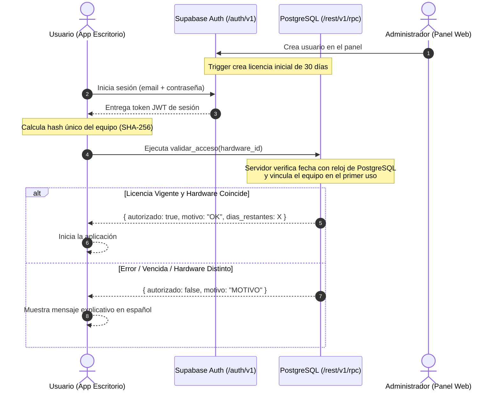

# subscription-gate

> **Plantilla didáctica y segura para añadir login, suscripción con vencimiento y amarre a un equipo a una aplicación de escritorio, con costo $0, usando Supabase y un panel web en Vue 3.**

[](https://opensource.org/licenses/MIT)
[](https://vuejs.org/)
[](https://supabase.com/)
[](https://tailwindcss.com/)

---

## English Summary

**`subscription-gate`** is an open-source, educational template to add **authentication**, **expiration-based subscriptions**, and **single-machine hardware binding (1 device per license)** to any desktop application at zero cost. It leverages the Supabase Free Tier (PostgreSQL + Auth + Row Level Security) and includes a responsive, minimalist dark-mode web management panel built with Vue 3 and Tailwind CSS, plus a cross-platform Python desktop client example (`httpx`).

- **Key Highlights:** Database-level security via RLS policies, server-side clock verification (`now()`), `SECURITY DEFINER` functions with fixed `search_path`, no public signups, and strict client privilege separation.

---

## ¿Qué problema resuelve?

Muchos desarrolladores independientes y creadores de herramientas de escritorio (creadas en Python, C#, Electron, Tauri o Go) necesitan una manera sencilla de:
1. Exigir inicio de sesión con correo y contraseña.
2. Comprobar que la suscripción del cliente no haya expirado.
3. Evitar que una misma cuenta se comparta libremente entre múltiples ordenadores (amarre de hardware).
4. Administrar renovaciones (+30, +90, +365 días), bloqueos y reseteos desde cualquier lugar (incluyendo el celular) sin pagar servidores mensuales.

`subscription-gate` resuelve esto delegando toda la seguridad en el motor PostgreSQL de Supabase y ofreciendo un panel de administración web listo para desplegar gratis.

---

## Arquitectura y Flujo de Verificación



---

## Alcance: Qué incluye y qué NO incluye

### Incluye (Básico pero Seguro)
- **Autenticación robusta:** Supabase Auth con correo y contraseña.
- **Row Level Security (RLS) estricta:** El usuario final únicamente puede leer su propia fila; no puede insertar, alterar su fecha de vencimiento ni borrar datos.
- **Reloj autoritativo en el servidor:** Imposible extender la suscripción cambiando la fecha local del ordenador.
- **Vinculación 1:1 de hardware:** El primer equipo que valide queda registrado; cualquier intento desde otro ordenador es rechazado.
- **Panel Web Moderno (`admin-web`):** Construido en Vue 3, Vite y Tailwind CSS con diseño minimalista oscuro (#09090b), métricas en tiempo real y controles adaptados para escritorio y móvil.
- **Cliente de escritorio didáctico (`client-python`):** Script multiplataforma con `httpx` (Windows, macOS, Linux) con detección de hardware y traducción de errores.
- **Guías completas:** Configuración paso a paso de Supabase, despliegue a costo 0 e integración genérica.

### NO incluye a propósito (Frontera didáctica de la plantilla)
Para mantener la plantilla simple, comprensible y de costo cero, los siguientes elementos no forman parte de este repositorio:
- **Tokens firmados asimétricamente y modo offline:** Requiere internet en cada validación.
- **Pasarelas de cobro automatizadas y Stripe Webhooks:** La renovación y el alta son manuales desde el panel.
- **Múltiples dispositivos por licencia o desvinculación en autoservicio.**
- **Edge Functions de Supabase.**
- Consulta [`SECURITY.md`](SECURITY.md) para conocer la guía de endurecimiento hacia un entorno comercial.

---

## Inicio Rápido en 6 Pasos

### 1. Usar esta plantilla
Haz clic en el botón verde **"Use this template"** en GitHub para clonar este proyecto en tu propia cuenta.

### 2. Crear proyecto en Supabase (Plan Gratuito)
Crea una cuenta en [supabase.com](https://supabase.com) y crea un nuevo proyecto con el plan **Free** ($0/mes).

### 3. Desactivar registro público
En la consola de Supabase, ve a **Authentication** &rarr; **Email** (o **Configuration**) y desactiva **"Enable Signups"**. Esto garantiza que solo el administrador pueda dar de alta nuevas cuentas.

### 4. Ejecutar las migraciones SQL
Abre el **SQL Editor** de Supabase y ejecuta en orden:
1. [`supabase/migrations/001_esquema.sql`](supabase/migrations/001_esquema.sql) (Tablas, RLS y trigger).
2. [`supabase/migrations/002_funciones.sql`](supabase/migrations/002_funciones.sql) (Funciones RPC y permisos restringidos).

### 5. Crear tu usuario Administrador
1. Ve a **Authentication** &rarr; **Users** &rarr; **Add user** y crea tu correo con contraseña.
2. Copia el **UID** del usuario.
3. En el **SQL Editor**, ejecuta:
   ```sql
   INSERT INTO public.admins (user_id) VALUES ('TU-UUID-AQUI');
   ```

### 6. Configurar y Probar
- **Panel Web:**
  ```bash
  cd admin-web
  cp .env.example .env
  # Completa VITE_SUPABASE_URL y VITE_SUPABASE_ANON_KEY con las credenciales de tu proyecto
  npm install
  npm run dev
  ```
  Abre `http://localhost:5173`, inicia sesión y verás tu panel de control de licencias.

- **Cliente Python:**
  ```bash
  cd client-python
  pip install -r requirements.txt
  python ejemplo_cliente.py
  ```

---

## Costo Cero ($0): Servicios y Límites Orientativos

La arquitectura de `subscription-gate` está diseñada para funcionar íntegramente en los niveles gratuitos estándar:

| Servicio | Componente | Límite Orientativo del Plan Gratuito |
|---|---|---|
| **Supabase Free Tier** | Base de Datos PostgreSQL + Auth | Hasta 50,000 usuarios activos mensuales (MAU), 500 MB de base de datos, 5 GB de ancho de banda. |
| **Cloudflare Pages / Vercel** | Hosting del Panel Web (`admin-web`) | Ancho de banda ilimitado o generoso, compilaciones automáticas y certificado SSL gratis. |
| **GitHub** | Código fuente y versionado | Repositorio público ilimitado y GitHub Actions. |

> [!NOTE]
> *Aviso importante:* Los límites y condiciones de los planes gratuitos son definidos por cada proveedor y pueden variar con el tiempo. Verifica siempre los términos y políticas vigentes de Supabase y de tu proveedor de hosting.

---

## Cómo Integrar en tu App de Escritorio

El protocolo de validación es estándar sobre HTTP y puede implementarse en minutos en cualquier lenguaje:

1. **Login:** `POST /auth/v1/token?grant_type=password` &rarr; Obtén el `access_token`.
2. **Identificador de hardware:** Genera un hash SHA-256 único de 64 caracteres.
3. **Validación:** `POST /rest/v1/rpc/validar_acceso` con el Bearer token y el hardware hash.

Consulta la guía completa de integración con tablas de respuesta y buenas prácticas en [`docs/03_integrar_en_tu_app.md`](docs/03_integrar_en_tu_app.md).

---

## Estructura del Repositorio

```text
subscription-gate/
├── LICENSE                 # Licencia MIT ([COMPLETAR])
├── README.md               # Este documento (Español + Resumen en inglés)
├── SECURITY.md             # Garantías de seguridad, límites y endurecimiento
├── CONTRIBUTING.md         # Pautas de contribución comunitaria
├── .env.example            # Plantilla de variables de entorno
├── supabase/
│   ├── migrations/
│   │   ├── 001_esquema.sql       # Tablas, RLS y trigger de bienvenida
│   │   ├── 002_funciones.sql     # RPC validar_acceso y admin_*
│   │   └── 003_admin_ejemplo.sql # Asignación del primer administrador
│   └── tests/
│       └── rls.sql               # Suite de verificación de RLS y permisos
├── admin-web/              # Panel web en Vue 3 + Vite + Tailwind CSS
│   ├── src/
│   │   ├── lib/supabase.js       # Cliente Supabase (solo anon key)
│   │   ├── router/index.js       # Rutas y guardias de seguridad
│   │   └── pages/
│   │       ├── Login.vue         # Login seguro con verificación admin
│   │       └── Usuarios.vue      # Métricas, tabla/tarjetas y acciones
│   └── .env.example
├── client-python/          # Cliente didáctico de escritorio
│   ├── requirements.txt    # Dependencias fijas (httpx)
│   └── ejemplo_cliente.py  # Script multiplataforma documentado
└── docs/
    ├── 01_configurar_supabase.md    # Paso a paso en la consola de Supabase
    ├── 02_desplegar_panel_gratis.md # Despliegue en Cloudflare Pages / Vercel
    └── 03_integrar_en_tu_app.md     # Especificación HTTP para cualquier app
```

---

## Licencia

Este proyecto está distribuido bajo la licencia **MIT**. Consulta el archivo [`LICENSE`](LICENSE) para más detalles.
