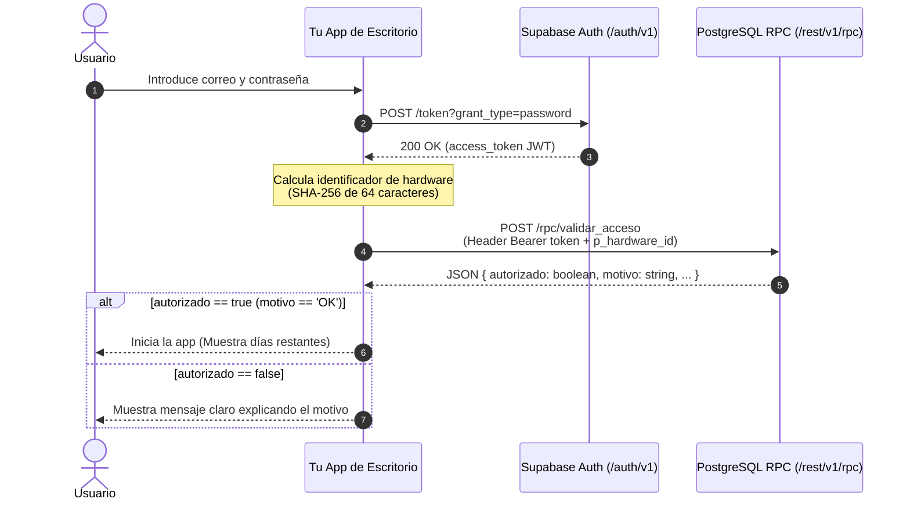

# 03. Cómo Integrar el Control de Licencias en tu App

Esta guía explica la arquitectura de red y el protocolo para integrar `subscription-gate` en cualquier tecnología de aplicación de escritorio (C#, Electron, Tauri, Rust, Go, Python, C++, etc.).

---

## 1. Diagrama de Secuencia

El flujo completo se resume en 3 pasos estándar sobre HTTP REST:



---

## 2. Paso a Paso del Protocolo HTTP

### Paso 1: Autenticación de Usuario (Login)
Solicita al usuario sus credenciales e invoca el endpoint de autenticación de Supabase Auth:

- **Método:** `POST`
- **URL:** `https://<TU-PROYECTO>.supabase.co/auth/v1/token?grant_type=password`
- **Cabeceras:**
  ```http
  apikey: <TU-ANON-KEY>
  Content-Type: application/json
  ```
- **Cuerpo (JSON):**
  ```json
  {
    "email": "cliente@ejemplo.com",
    "password": "contraseña_del_cliente"
  }
  ```
- **Respuesta esperada (200 OK):**
  ```json
  {
    "access_token": "eyJhbGciOi...",
    "token_type": "bearer",
    "expires_in": 3600,
    "user": { ... }
  }
  ```

---

### Paso 2: Cálculo del `hardware_id`
Genera un identificador único, persistente y estable del equipo:
- Debe tener **exactamente 64 caracteres** en formato hexadecimal (salida estándar de SHA-256).
- Recomendación: combina un identificador del hardware con una sal secreta embebida en tu aplicación para evitar que el hash sea predecible o idéntico entre distintos productos:
  $$\text{hardware\_id} = \text{SHA256}(\text{GUID\_del\_sistema} + \text{"|"} + \text{hostname} + \text{"|"} + \text{sal\_secreta})$$
- Consulta [`client-python/ejemplo_cliente.py`](../client-python/ejemplo_cliente.py) para ver cómo obtener el UUID de placa en Windows (`MachineGuid`), macOS (`IOPlatformUUID`) y Linux (`/etc/machine-id`).

---

### Paso 3: Validación de Licencia y Amarre de Equipo
Envía el JWT obtenido en el Paso 1 y el hash de hardware a la función RPC:

- **Método:** `POST`
- **URL:** `https://<TU-PROYECTO>.supabase.co/rest/v1/rpc/validar_acceso`
- **Cabeceras:**
  ```http
  apikey: <TU-ANON-KEY>
  Authorization: Bearer <access_token_del_paso_1>
  Content-Type: application/json
  ```
- **Cuerpo (JSON):**
  ```json
  {
    "p_hardware_id": "9b6fae7d2c7b898abd39bb2904d4b15e30785ac689c55a94498718782cc82db5"
  }
  ```

---

## 3. Catálogo de Respuestas y Manejo de Errores

| `autorizado` | `motivo` | Significado | Mensaje recomendado para el usuario |
|---|---|---|---|
| `true` | `OK` | Licencia vigente y equipo verificado. Devuelve `dias_restantes` y `expira_en`. | *"Bienvenido. Tu suscripción está activa (te quedan X días)."* |
| `false` | `HARDWARE_NO_COINCIDE` | La licencia ya está amarrada a otro ordenador. | *"Esta licencia está vinculada a otro ordenador. Si cambiaste de equipo, solicita un reseteo al administrador."* |
| `false` | `LICENCIA_EXPIRADA` | La fecha de expiración ya pasó. Devuelve `expira_en`. | *"Tu suscripción finalizó el [fecha]. Contacta al administrador para renovar tu acceso."* |
| `false` | `CUENTA_BLOQUEADA` | Bloqueada manualmente por el admin. | *"Tu cuenta ha sido suspendida. Contacta a soporte para más información."* |
| `false` | `SIN_LICENCIA` | El usuario existe en Auth pero no tiene registro en `licencias`. | *"No se encontró una licencia activa para tu cuenta. Contacta al soporte."* |
| `false` | `HARDWARE_INVALIDO` | El parámetro `p_hardware_id` no tiene 64 caracteres. | *"Error interno: el identificador de equipo generado no es válido."* |
| `false` | `NO_AUTENTICADO` | El token JWT no es válido o caducó. | *"Sesión no autorizada. Por favor vuelve a iniciar sesión."* |

---

## 4. Buenas Prácticas de UX en Aplicaciones de Escritorio

1. **Nunca bloquees al usuario de forma silenciosa ni crashees la app:** Si el acceso es rechazado, presenta una ventana modal con el mensaje traducido al usuario y un botón directo para copiar su correo o contactar con tu canal de soporte.
2. **Aviso preventivo de vencimiento:** Si `dias_restantes <= 7`, muestra un aviso discreto en la barra de estado de tu app: *"Tu suscripción vencerá en X días. Recuerda renovarla para evitar interrupciones."*
3. **Persistencia local de sesión:** Puedes guardar el `refresh_token` o `access_token` en el almacenamiento seguro de cada plataforma (ej. *Windows Credential Manager*, *macOS Keychain*, o *Secret Service* en Linux) para evitar que el usuario deba escribir su contraseña en cada inicio de la app.
4. **Validación periódica:** Realiza una llamada a `validar_acceso` al iniciar la app y, opcionalmente, una vez cada varias horas si la app permanece abierta continuamente.
